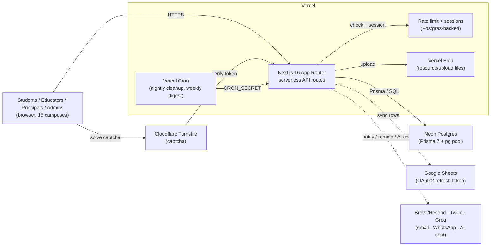

# High-Level Design

System-level view: the major pieces, how they talk to each other, and the
decisions that shape everything downstream. For how a specific feature
works, see `LLD.md`.

## System diagram

## The decisions that shape everything else

**One app, four portals, one API.** Admin, educator, principal, and student
each get their own route tree (`app/admin`, `app/educator`, `app/principal`,
`app/student`) and their own session cookie (staff share `rysen_session`;
students get `rysen_student_session`), but every portal calls into the same
`app/api/**/route.ts` handlers. There is no separate backend service — the
API routes _are_ the backend, deployed as part of the same Next.js build.

**No background workers.** The only thing that runs on a schedule is Vercel
Cron (nightly cleanup, weekly digest). Everything else is synchronous
request → response. The one case that looks like it needs a queue — updating
a Google Sheet after a student submits a test — uses `after()` to keep the
serverless function alive just long enough to finish that one write after the
response has already gone back to the student, rather than making the
student wait for a third-party API, and without spinning up a queue for a
single use case.

**Sessions are rows, not tokens.** A JWT would mean one fewer database query
per request, but it would also mean a compromised or reset credential stays
valid until it expires on its own. Every session is a row in the `Session`
table; revoking it (password reset, deactivation) is one `DELETE`.

**The database heals itself, carefully.** A fresh Neon database has none of
the app's tables. Rather than require someone to SSH in and run migrations
before the app can even show a login page, `lib/schema-heal.ts` checks
`information_schema` on cold start and creates exactly the columns/tables
auth needs (nothing else) under a short lock timeout, so a busy table can
never queue every login behind a stuck DDL statement. The full migration
list (`lib/migrations.ts`) runs once an admin actually logs in. Each entry's
`check` query decides whether it still needs to run — this is also the exact
mechanism that once had a bug (see `TESTING.md`): an inverted check meant a
legacy-table-drop ran on _every_ admin session instead of only when the
legacy table shape was actually present.

**External services are additive, never load-bearing.** Email, WhatsApp,
Google Sheets sync, and the AI assistant can all be completely unconfigured
and the core product (login, take a test, complete training, manage
students) still works end to end. Each one checks its own env vars and
no-ops or falls back rather than failing the request that triggered it.

## Component responsibilities

| Component                                                                                          | Responsibility                                                                                                           | Does NOT do                                                                 |
| -------------------------------------------------------------------------------------------------- | ------------------------------------------------------------------------------------------------------------------------ | --------------------------------------------------------------------------- |
| Next.js App Router pages                                                                           | Render the UI per portal/role; call the API, hold client-side state                                                      | Query the database directly, verify permissions                             |
| API route handlers                                                                                 | Authenticate the session, check the caller's role/campus/ownership, query Prisma, shape the response                     | Render HTML, know about any specific portal's UI                            |
| `lib/auth.ts` / `lib/student-auth.ts`                                                              | Create, read, and revoke sessions                                                                                        | Decide _who's allowed to do what_ — that's per-route                        |
| `lib/branch-scope.ts`, `lib/task-access.ts`, `lib/stage-audience.ts`, `lib/student-test-access.ts` | The actual access-control rules (campus scoping, task assignment, stage/attempt gating), each testable as pure functions | Touch the database themselves — callers pass in the already-fetched record  |
| `lib/rate-limit.ts`                                                                                | Count attempts per key per window, shared across serverless instances                                                    | Decide what should be rate-limited — each route picks its own key and limit |
| Prisma + Neon                                                                                      | Durable storage, relational integrity (cascades, uniqueness), indexes                                                    | Business logic                                                              |
| Vercel Cron                                                                                        | Fire two scheduled requests                                                                                              | Retry on failure, queue work, run anything else                             |

## What scales and what doesn't (yet)

**Scales fine as campus count grows:** the data model is already
campus-scoped (`branchId` on every relevant table, 14 indexes on the hot
query paths), and adding a campus is a row insert, not a code change.

**Would need attention past a few hundred concurrent users:** the Postgres
connection pool is capped low per serverless instance (`DB_POOL_MAX`,
default 5) specifically because many concurrent Vercel instances × a larger
pool would exhaust Neon's connection limit — this trades per-instance
throughput for safety at scale, and is the first thing to revisit if traffic
grows. See `HANDOVER.md` → "What breaks first" for the other two known
pressure points (Google Sheets quota, OAuth token expiry).

**Not built for:** true real-time (group chat polls every 5 seconds, not a
websocket); multi-region (Vercel is pinned to `iad1`, US East, regardless of
where campuses actually are); offline use (every page assumes a live API
call).
