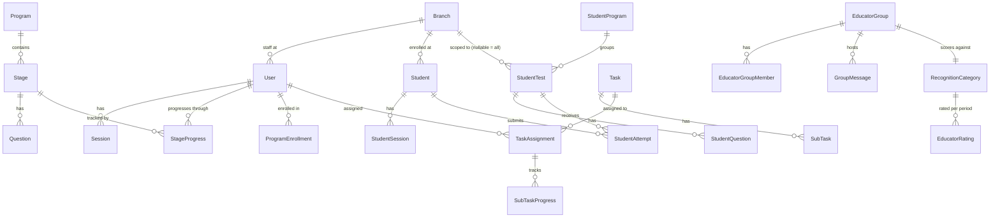
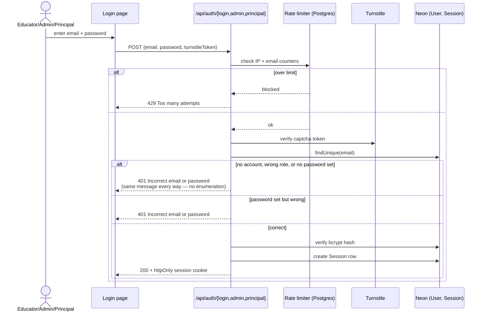
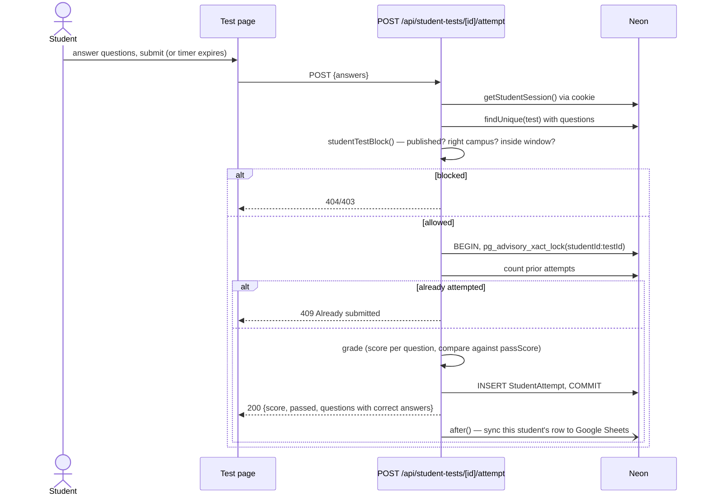

# Low-Level Design

How specific things actually work — the data model, the request flow for the
two most intricate features, and the access-control building blocks every
route composes from. Read `HLD.md` first if you haven't; this picks up where
that leaves off.

## Data model (core relationships)

The full schema (40+ models) is in `prisma/schema.prisma`; this is the
subset that explains how a request gets scoped to the right rows. Two fields
recur everywhere and carry real meaning:

- **`branchId` (nullable)** — on `Student`, `StudentTest`, `StudentProgram`,
  `Program`. `null` means "applies to every campus," not "unset." An
  educator's queries always include both their own campus's rows and the
  `null` rows — see `educatorBranchListWhere()` in `lib/branch-scope.ts`.
- **`createdById`** — on `Student`, `Task`, `TaskGroup`, `StudentProgram`.
  Combined with `branchId`, this is how ownership and campus scoping
  compose: an educator can always see what they created, plus
  campus-matching rows created before a specific cutoff date
  (`CREATED_BY_SCOPE_CUTOFF` in `lib/student-scope.ts` — students added
  before the per-educator attribution existed are grandfathered as
  branch-visible, since there's no way to know who _actually_ added them).

## Access control: the shared building blocks

Every route that needs more than "is there a session" composes from a small
set of pure, independently-tested functions rather than repeating role
checks inline:

| Function                                                  | File                         | Answers                                                                                                      |
| --------------------------------------------------------- | ---------------------------- | ------------------------------------------------------------------------------------------------------------ |
| `canAccessBranchRecord(user, record, mode)`               | `lib/branch-scope.ts`        | Can this educator read/edit this campus-scoped row? (read = own campus + all-campus; edit = own campus only) |
| `educatorStudentWhere(userId, branchId)`                  | `lib/student-scope.ts`       | The Prisma `where` clause for "students this educator can see," composing ownership + the legacy cutoff      |
| `countedStageWhere(role)` / `isStageForRole(stage, role)` | `lib/stage-audience.ts`      | Does this stage count toward _this role's_ completion (published + applicable-to-role)?                      |
| `studentTestBlock(test, student, now)`                    | `lib/student-test-access.ts` | Is this test published, in-campus, and inside its schedule window for this student right now?                |
| `canAccessTask(user, taskId)`                             | `lib/task-access.ts`         | Is this user an admin, or actually assigned to this task?                                                    |

Each one takes already-fetched data and returns a decision — none of them
query the database themselves, which is why `tests/unit/access-rules.test.ts`
can test every branch of every rule with no mocking at all.

## Flow 1: staff login + first-time setup

**Why "no password set" and "wrong password" return the identical
response:** an attacker probing emails can't tell which ones exist in the
system from the error alone. The one place this _does_ need to differ — a
legitimate first-time user needs to be routed to setup, not just told "no" —
is handled with a separate `code: 'NO_PASSWORD'` field the UI checks, which
doesn't change the user-visible error text.

**First-time setup** (`lib/account-setup-otp.ts`) is a separate two-step
flow, not a variant of login: `POST /api/auth/request-setup-otp` confirms the
typed name matches an unset-password account, emails a 6-digit code, and
returns a JWT whose payload carries only an **HMAC** of that code (keyed
with a server secret the browser never sees — a plain hash would let the
code be brute-forced offline from the readable JWT payload in under a
second). `POST /api/auth/set-password` requires that code back, rate-limited
to 5 guesses per emailed code, before it will set the password and create a
session.

## Flow 2: student submits a test

**The advisory lock matters because the attempt cap is a race condition
otherwise:** two near-simultaneous submits (a slow network retry, a
double-tap) could both pass the "count prior attempts" check before either
one's `INSERT` lands, producing two attempts where the product only allows
one. `pg_advisory_xact_lock(hashtext(studentId:testId))` serializes any two
requests for the _same_ student+test without taking a table-wide lock that
would slow down every other student's submission.

**Why the Sheets sync happens in `after()`, not before the response:** the
student is waiting on this response; a slow or failed third-party API call
must never be the reason their test result is slow to show up. `after()`
keeps the serverless function alive just long enough to finish that write
after the response has already gone to the browser — the same pattern used
for welcome emails after a bulk educator import.

## Flow 3: certificate auto-unlock

A programme's certificate isn't generated — it's a live query. `GET
/api/certificate?programId=X` checks that the user is enrolled in that
programme and that every `Stage` under it (filtered to stages that are
_published_ and _applicable to that user's role_ — see `isStageForRole`)
has a passed `StageProgress`. If both hold, the certificate data is returned;
if not, `403`.

The "unlock" notification is a side effect of grading, not a separate check:
`POST /api/mcq/[stageId]` grades the attempt, and if this was the attempt
that newly passed the stage, it re-runs the same "every sibling stage
passed?" check inline. If true, it fires a `Notification` of type
`CERTIFICATE`. This is why a draft (unpublished) stage added to a programme
used to lock every already-finished educator out of a certificate they'd
earned — the "every stage passed" check didn't filter by `isPublished` until
that was fixed; `isStageForRole`/`countedStageWhere` now share one
definition of "counts" across the certificate route, the certificate list,
and the notification trigger, so the three can't disagree again.

## Where business logic lives vs. where it doesn't

| Lives in the route handler                            | Lives in a shared `lib/` function                     |
| ----------------------------------------------------- | ----------------------------------------------------- |
| Parsing and validating the request body               | Deciding if this user can see/edit this row           |
| Fetching the specific records this request needs      | Grading rules, attempt caps, schedule windows         |
| Shaping the JSON response                             | Hashing/verifying passwords, signing/verifying tokens |
| Which Prisma calls run, and in what order/transaction | Rate-limit counting                                   |

The rule of thumb used throughout this codebase: if a decision needs to be
made the same way in more than one route (or needs its own test without a
database), it becomes a named function in `lib/`. If it's specific to one
route's request/response shape, it stays inline.
