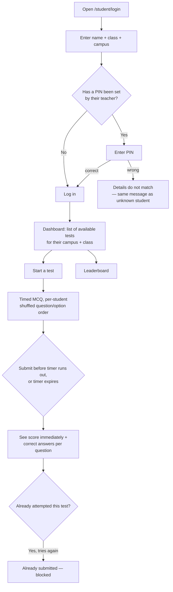
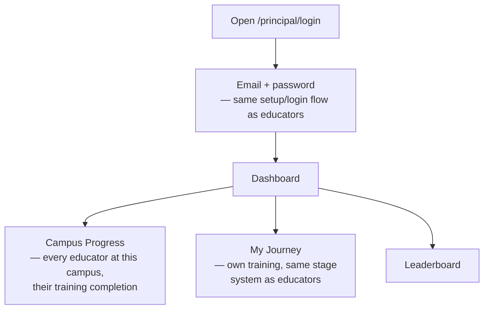
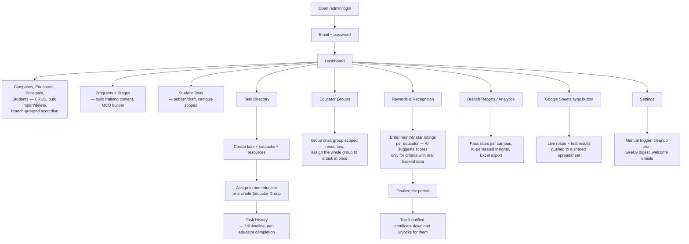

# User Flows

What each role actually clicks through. Written for product review, QA
scripting, and anyone new to the team — no code required to follow this
page; see `LLD.md` if you want the request/response detail behind any step.

## Student



**Who can't do this:** a student outside their campus never sees another
campus's tests; an unpublished or out-of-schedule-window test never appears,
and even if its ID is guessed directly, the server blocks it the same way.

## Educator (teacher)

```mermaid
flowchart TD
    A[Open /login] --> B{First time?}
    B -->|Yes| C[Request setup code by email]
    C --> D[Enter code + choose password]
    D --> E[Logged in]
    B -->|No| F[Email + password]
    F --> E

    E --> G[Dashboard: training journey +<br/>"Ask Rysen AI" banner]
    G --> H[Complete training stages<br/>— MCQ, pass threshold, limited attempts]
    H --> I{All stages in an<br/>enrolled programme passed?}
    I -->|Yes| J[Certificate auto-unlocks<br/>+ in-app notification]

    G --> K[Create/manage own students]
    K --> L[Create a test for them<br/>— question bank, schedule window]
    L --> M[Students take it; educator<br/>sees results + at-risk flags]

    G --> N[Assigned tasks]
    N --> O[Mark subtasks done,<br/>comment, ask AI about the task]

    G --> P[My Groups]
    P --> Q[Group chat with fellow educators<br/>+ group-scoped shared resources]

    G --> R[Monthly recognition]
    R --> S[Star rating, rank, leaderboard]
    S --> T{Top 3 this month?}
    T -->|Yes| U[Certificate download unlocks]
```

**Who can't do this:** an educator never sees or edits another campus's
tests or students (except all-campus/legacy ones, which they can _read_ but
not edit); they only see tasks they're actually assigned to, not every task
in the system.

## Principal (campus head)



A principal's view is deliberately narrow: oversight of their own campus's
educators, plus their own training — not student data, not other campuses.

## Admin (head office)



**The one thing that happens without an admin clicking anything:** the
weekly digest email (every Sunday, Vercel Cron) and the nightly cleanup of
old notifications and orphaned uploaded files. Everything else in this
column is admin-initiated.

## Cross-cutting: what happens on a password reset

This one spans two roles, which is why it's easy to get wrong and worth
tracing on its own:

```mermaid
flowchart LR
    A[Admin clicks<br/>"Reset Password"<br/>on an educator] --> B[Server clears<br/>User.password to null]
    B --> C[Server deletes every<br/>Session row for that user]
    C --> D[Educator is signed out<br/>on every device immediately]
    D --> E[Educator's next login attempt<br/>returns NO_PASSWORD]
    E --> F[Routed to first-time setup<br/>— email code, new password]
```

Before this was fixed, step C didn't happen: an educator's _existing_
sessions stayed valid after a reset, so "reset their password" didn't
actually lock out someone who already had an active session — only future
logins were gated. The flow above is the current, corrected behavior.
